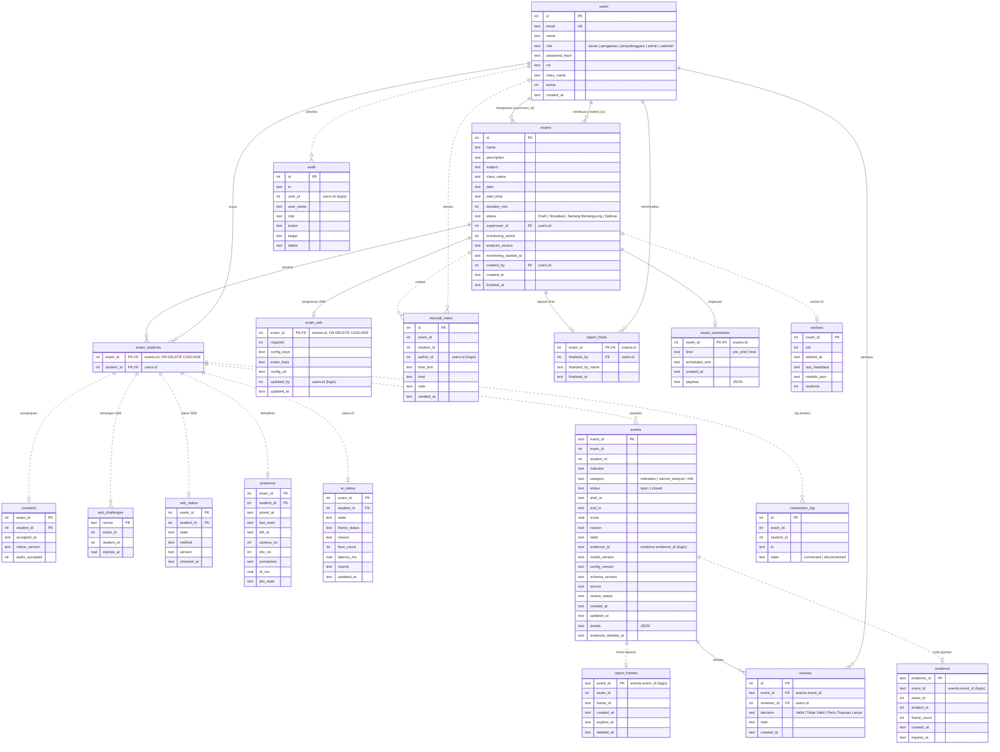

# Diagram relasional database EduAI

Sumber: skema SQLite di `backend/app/db.py` (19 tabel, termasuk kolom tambahan dari migrasi). Gambar: [ERD.png](ERD.png).

- **Garis tegas**: relasi yang dideklarasikan sebagai `REFERENCES` (foreign key) di skema.
- **Garis putus-putus**: relasi logis. Kolomnya merujuk tabel lain, tetapi tanpa constraint foreign key. Tabel per siswa per ujian memakai pasangan `(exam_id, student_id)` yang sama dengan `exam_students`.

Catatan:
- `presence`, `ai_status`, `seb_status`, dan `consents` menyimpan paling banyak satu baris per siswa per ujian (kunci primer `(exam_id, student_id)`).
- Kejadian berkategori `info` (label suara) disimpan di `events` dengan detail di kolom `details`. Kejadian ini tidak dihitung sebagai indikasi.
- `sqlite_sequence` adalah tabel internal SQLite untuk `AUTOINCREMENT` dan tidak digambar.
